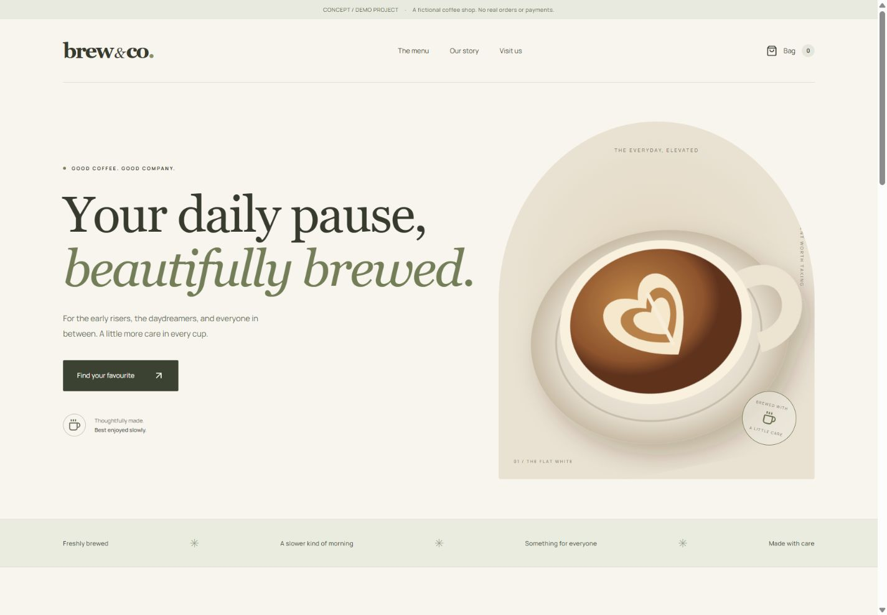
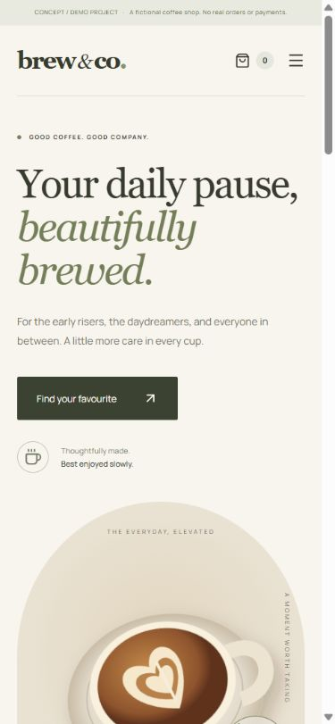

# Brew & Co. — Concept / Demo Project

A complete, independent Next.js demo for a fictional coffee shop. Built by Andranik Harutyunyan. This is not a commercial client commission.

## Run

Node.js 20.9+ is required (tested with Node.js 24.14.0).

```sh
npm ci
npm run dev -- --port 3101
```

Open http://127.0.0.1:3101. On Windows PowerShell use `npm.cmd` if script execution is restricted.

```sh
npm run typecheck
npm run lint
npm run build
npm run start -- --port 3101
```

## Working features

- Six typed menu products, category filters and responsive navigation.
- Interactive bag: add, decrease, increase, remove, total and empty state.
- Whole-cent USD calculations and a maximum of 20 units of each product.
- Native modal dialog with keyboard Escape and a clearly labelled demo checkout.
- Original SVG coffee and bakery illustrations, local Manrope font and reduced-motion support.

The bag is held in tab memory and intentionally resets on reload. No server orders, payments, accounts, analytics or external services are connected. Products, prices and contacts are fictional. `.example` is used for the illustrative contact; no contact submission is offered.

## Source structure

`app/` contains routes, styles, metadata and robots. `components/storefront.tsx` implements the interactive catalogue and bag. `components/coffee-art.tsx` contains original SVG artwork. `data/menu.ts` is the single product source.

## Vercel readiness

`vercel.json` configures Next.js and `npm ci`. No environment variables or secrets are needed. The demo is intentionally noindex. A production deployment must only be created after owner approval. No public GitHub or deployment URL is claimed in this source.

Use this folder as the root directory of the separate `brew-co-demo` repository. `node_modules`, `.next`, environment files, private keys and local deployment state are ignored. See `QA.md` for the verification record.

## Preview

Actual browser captures of the running production build.




